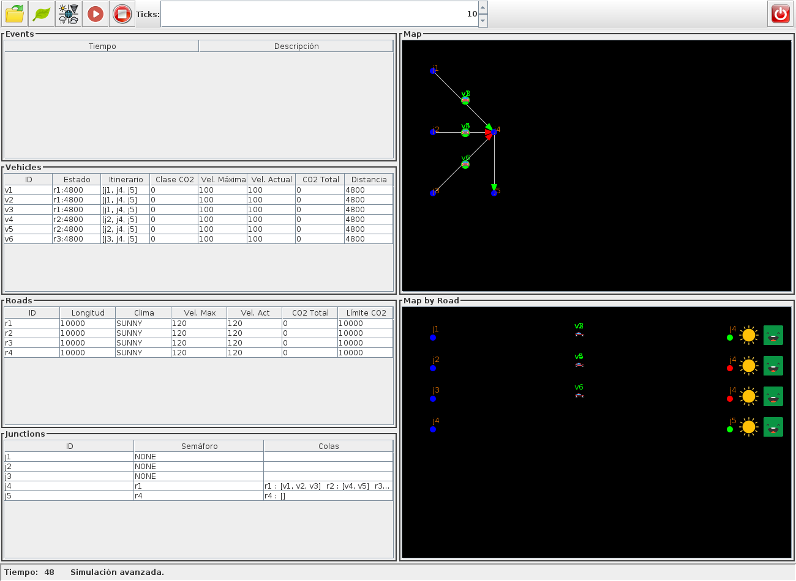
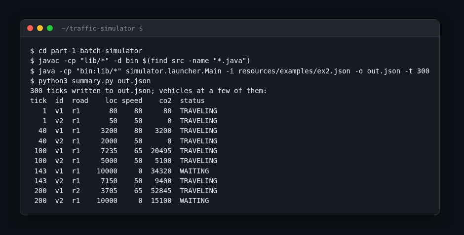

# Traffic Simulator

A small event-driven traffic simulator written in Java: junctions with traffic lights, roads, vehicles with routes and CO2 classes, and a Swing window to watch it run.



## What it is

Assignment for Programming Technology 2 (Tecnología de la Programación 2) at UCM, second year, spring 2025. It came in two parts, so the repo has two folders. Part 1 is the simulation engine plus a command-line launcher that reads a JSON file of events and writes a JSON report of every tick. Part 2 is the same engine (copied forward, not shared) with an observer layer and a Swing GUI on top: tables of events, vehicles, roads and junctions, two map views, a control panel and a status bar.

## How it works

- A `TrafficSimulator` holds a `RoadMap` (junctions, roads, vehicles) and a queue of `Event`s sorted by time. Each tick it fires the events due, advances every junction and road, then builds a JSON snapshot of the state.
- Events come from JSON through a `BuilderBasedFactory`, one `Builder` per event type (new junction, city road, intercity road, vehicle, set weather, set CO2 class). The same factory pattern picks the junction strategies.
- Junctions combine a light-switching strategy (`RoundRobin` or `MostCrowded`) with a dequeuing strategy (`MoveFirst` or `MoveAll`).
- Roads come in two flavours, `CityRoad` and `InterCityRoad`, with different rules for how weather and pollution change the speed limit.
- Vehicles move along a route of junctions, emit CO2 based on their class and speed, and queue at junctions until the light is green.
- Part 2 makes the simulator `Observable`; every Swing component implements `TrafficSimObserver` and repaints itself on each event.



## Stack

Java 17 or newer, Swing, Apache Commons CLI 1.4 and org.json (both in `lib/`), JUnit 5 for the tests.

## Run it

Part 1, batch mode (ticks default to 20):

```
cd part-1-batch-simulator
mkdir -p bin
javac -cp "lib/*" -d bin $(find src -name "*.java")
java -cp "bin:lib/*" simulator.launcher.Main -i resources/examples/ex2.json -o out.json -t 300
```

Part 2, GUI (without `-m gui` the launcher runs in console mode, like part 1):

```
cd part-2-swing-gui
mkdir -p bin
javac -cp "lib/*" -d bin $(find src -name "*.java")
java -cp "bin:lib/*" simulator.launcher.Main -m gui -i resources/examples/ex4.json
```

Run from inside the part folder: icons and example files are loaded by relative path. On Windows replace `:` with `;` in the classpath. `resources/examples/` has inputs with their expected outputs; `extra.testing.TestExamples` runs them all and diffs the results.

## Team

- Luis Molina Salvador (34lumo)
- David Arranz (Tuligambas, davidarranz)
